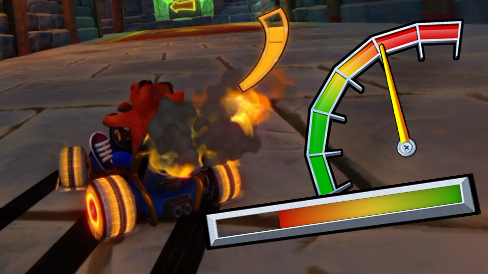
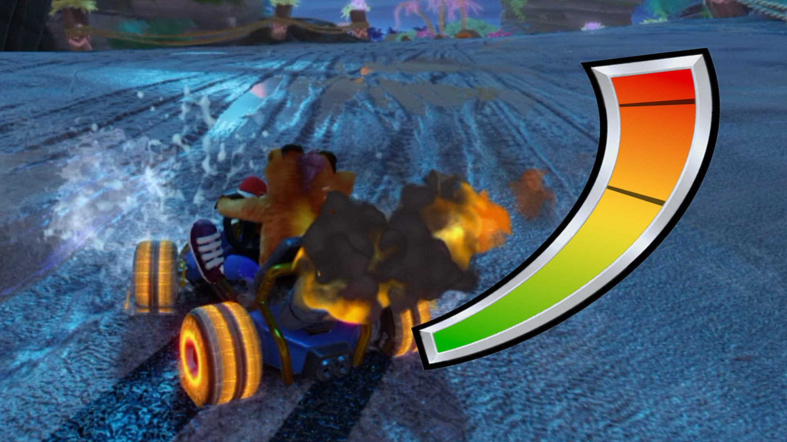
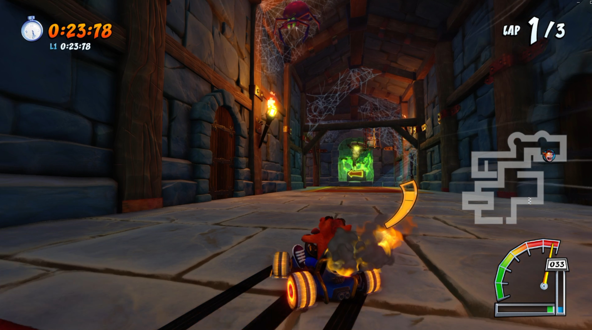

# CNK Drift Gauge + Reserves Meter — EU Edition

**EU adaptation by [Majed-allababedi](https://github.com/Majed-allababedi). Original mod by [tomtotom](https://gamebanana.com/members/6031042).**

A European-edition compatibility adaptation of **[CNK Drift Gauge + Reserves Meter](https://gamebanana.com/mods/729041)** for Crash Team Racing: Nitro-Fueled (PC/OCTR).

> **Required game:** CUSA14876, update **01.21**. **Required HUD:** **Speedometer**. Classic and Nitro-Fueled HUD modes are not the intended interface for this mod.

## Download

[Download the latest release](https://github.com/Majed-allababedi/CTR-CNK-Drift-Gauge-EU/releases/latest) · [Compatible launcher / EU loader support](https://github.com/Majed-allababedi/OCTR-NitroFueled-PC)

The ZIP contains a declarative mod package, not the game. Use the ZIP from Releases rather than GitHub's repository source archive.

## Original features

The following features were created by **tomtotom** and are described on the [original GameBanana page](https://gamebanana.com/mods/729041):

- A curved CNK-style drift gauge beside the kart, switching sides with drift direction.
- A green → yellow → orange fill to help time drift boosts.
- A live reserves meter below the original speedometer, reading the game's boost state.
- Three display passes: **green: 0–20 seconds**, **yellow over green: 20–40**, **orange over yellow: 40–60**.
- Above 60 seconds the bar remains orange. This is a display limit, not a cap on actual reserves.
- Original speedometer artwork retained; boost timing, speed and gameplay mechanics are not changed by the original mod.

## What the EU adaptation changes

- Resolves **29 archive resources** by name to their EU indices.
- Preserves EU HUD language dependencies in **five HUD payloads**, including Arabic.
- Adapts the hook/helper calls for the tested EU executable and verifies **seven executable writes** with original-byte checks.
- Works with EU-aware loader selection, preflight and native launcher catalog display.
- Displays **`Majed-allababedi`** in the launcher author field. Original-author attribution remains in this README, LICENSE.md, the package README and executable patch metadata.

Version **1.0.6** shortens the launcher display name to **Majed-allababedi**, while retaining original-author and EU-adapter credit in the documentation and patch metadata. Its asset payloads and executable write addresses/values are unchanged from the locally tested EU conversion. This version number identifies this adaptation, not an official upstream release.

## Installation

1. Use a compatible OCTR launcher with the EU-aware mod-loader support from the [launcher repository](https://github.com/Majed-allababedi/OCTR-NitroFueled-PC). An unmodified loader that only accepts CUSA13795 packages is insufficient.
2. Back up your saves. Disable any standalone CNK/boost-gauge/reserves mod that overlaps this package.
3. Download `reserves-cnk-drift-gauge-eu-1.0.6.zip` from Releases, then use **Mods → Add files / Install ZIP**, or place the ZIP in the launcher's `mods` folder.
4. Press **Reload**, enable **Reserves + CNK Drift Gauge (EU 1.21)**, and fully restart the game.
5. **Select the Speedometer HUD inside the game**, enter a race, and drift/charge a boost to see the gauge.

Do not install the separate CNK Boost Gauge mod alongside this combined package.

### Nothing changed in-game?

Check the **Speedometer HUD** selection first. Merely seeing the package in the launcher does not change the selected game HUD. The EU conversion was confirmed working in gameplay by Majed-allababedi after the initial no-visible-change report; no further gameplay code change was necessary.

## Original screenshots

The screenshots below are **tomtotom's previews from the original GameBanana listing**. They illustrate the original mod's appearance; they are not screenshots of an independently tested EU build.

| Original preview | Original preview |
| --- | --- |
|  |  |

[Original demonstration video](https://www.youtube.com/watch?v=dIQqHX5c1DI)

## Verification and limitations

- The EU **CUSA14876 01.21** conversion was confirmed working in-game by the repository owner.
- The package manifest, resource hashes, EU indices, HUD dependency splice, seven code writes, call destinations and complete loader preparation path were checked locally.
- Mismatched original-byte hashes and cross-edition package preparation are rejected rather than silently skipping the executable patch.
- The release ZIP is CRC-checked and each extracted member is checked against `verification/package-files.json`. A SHA-256 file is attached to the release.
- Other executable variants, EU 01.00, ultrawide configurations and multiplayer behavior are **not certified by these checks**. The original page describes offline packaging; the inherited package online declaration is not a new multiplayer validation.
- No original game executable, save, keys or full game archives are included. You need your own game files.

## Credits, source and permissions

- **Original mod, artwork and display logic:** tomtotom — [GameBanana submission](https://gamebanana.com/mods/729041).
- **EU compatibility adaptation, packaging and gameplay confirmation:** Majed-allababedi.
- **Preview screenshots:** from the original GameBanana submission, credited to tomtotom.
- **OCTR / SacredFire and its contributors:** the launcher/runtime ecosystem; this repository does not claim authorship of that project.

The original page lists **Creative Commons Attribution-NonCommercial-NoDerivs 4.0** and requests permission for modified redistribution. The repository owner confirms receiving permission from tomtotom to publish this modified EU version on GitHub. Original ownership and attribution remain unchanged; this statement does not grant a blanket sublicense for further derivative redistribution. See [LICENSE.md](LICENSE.md).
